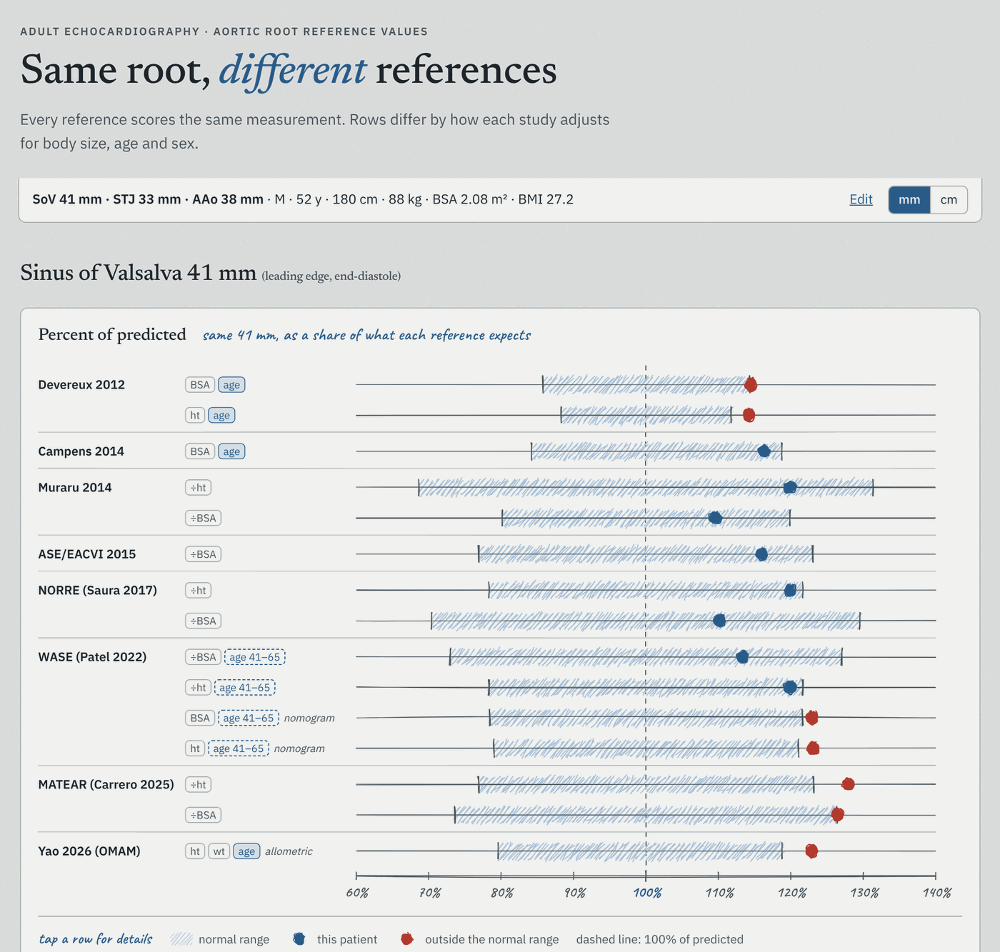

# [aoroot.parameterz.com](https://aoroot.parameterz.com)

**One adult aortic root measurement, scored against several published echocardiographic references side by side.**

Enter sex, age, height, weight and any of the four standard sites (annulus, sinuses of Valsalva, sinotubular junction, ascending aorta). Each reference that covers that site returns its predicted value, normal range, z-score and percent of predicted. There is no default or "headline" reference. The references disagree, sometimes by more than a z of 1, and the comparison is the point.

**[Open the calculator →](https://aoroot.parameterz.com)** · [References](https://aoroot.parameterz.com/references.html) · [About and how to cite](https://aoroot.parameterz.com/about.html) · [Tests](https://aoroot.parameterz.com/tests.html) · [Changelog](CHANGELOG.md)

## References included

| Reference | Journal |
|---|---|
| Devereux 2012 | Am J Cardiol |
| Mirea 2013 | J Am Soc Echocardiogr |
| Campens 2014 | Am J Cardiol |
| Muraru 2014 | Eur Heart J Cardiovasc Imaging |
| ASE/EACVI 2015 (Lang) | J Am Soc Echocardiogr |
| NORRE (Saura 2017) | Eur Heart J Cardiovasc Imaging |
| WASE (Patel 2022) | J Am Soc Echocardiogr |
| MATEAR (Carrero 2025) | Arch Cardiol Mex |
| Yao 2026 (OMAM) | MedComm |

Height-indexed risk and surgical thresholds (Desai 2026) and a cardiac MRI upper limit of normal (Tavolinejad 2025) are shown for context. The [References page](https://aoroot.parameterz.com/references.html) has every equation, population and note, and is the authoritative list.

## How references are chosen

- **No range, no model.** A paper is included only if it gives a spread (SD, SEE or published limit). Mean-only equations are left out.
- **Body size, not sex alone.** Every model shown adjusts for body size, age or both.
- **Race and ethnicity are never an input.** Each study's population is described in the paper's own words.
- **Every number is traceable** to the table or page it came from, and covered by tests that reproduce values printed in the paper wherever it prints any.

## Not a medical device

aoroot is an educational and reference tool for adults only. A z-score is one input to clinical judgment, not a diagnosis; check important results against the original publications. All calculation runs in the browser and nothing entered is stored or sent anywhere.

## Citing

Cite the reference you relied on, since that is where the numbers come from. To cite the calculator itself, use the citation on the [About page](https://aoroot.parameterz.com/about.html#cite), which carries the current version.

Dan Dyar, MA, ACS, RDCS, FASE · [LinkedIn](https://www.linkedin.com/in/dan-dyar-ma-acs-rdcs-ae-pe-fe-fase/) · ORCID [0000-0002-2025-8944](https://orcid.org/0000-0002-2025-8944)

---

## For developers

Static site, plain HTML + ES modules, no build step, served by GitHub Pages.

- `registry/` one data file per published reference (copy `_template.js`, add a line to `index.js`)
- `lib/covariates.js` the only variables references may use (age, sex, height, weight, BMI, BSA by formula)
- `lib/evaluator.js` all the math: mean / sd / dist types, `score()`, `impliedExponent()`
- `lib/validate.js` schema check
- `lib/version.js` site version (single source; see [CHANGELOG.md](CHANGELOG.md) for the release process)
- `docs/DESIGN.md` design notes and decisions

Run locally with `python3 -m http.server` and open <http://localhost:8000>.
Tests: `node tests/run.js`, or open `tests.html` from the local server.
